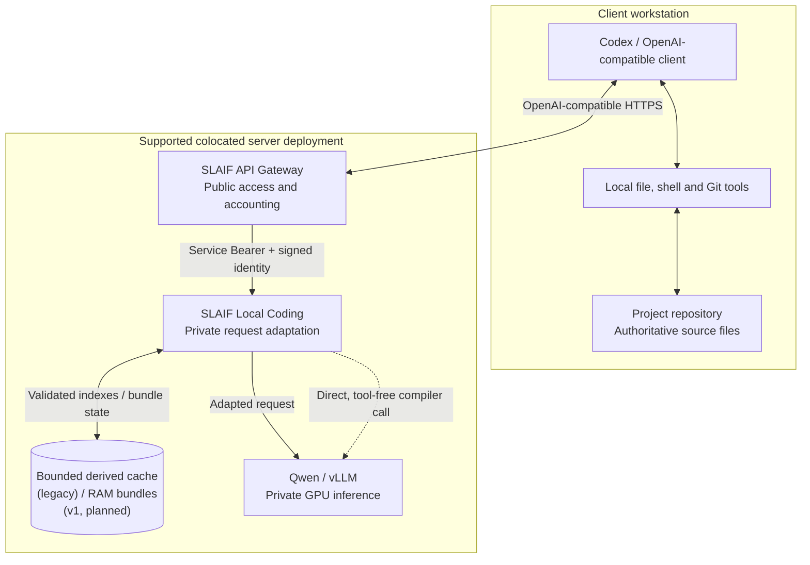
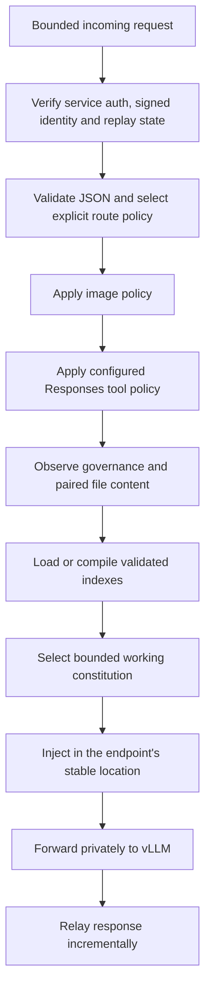
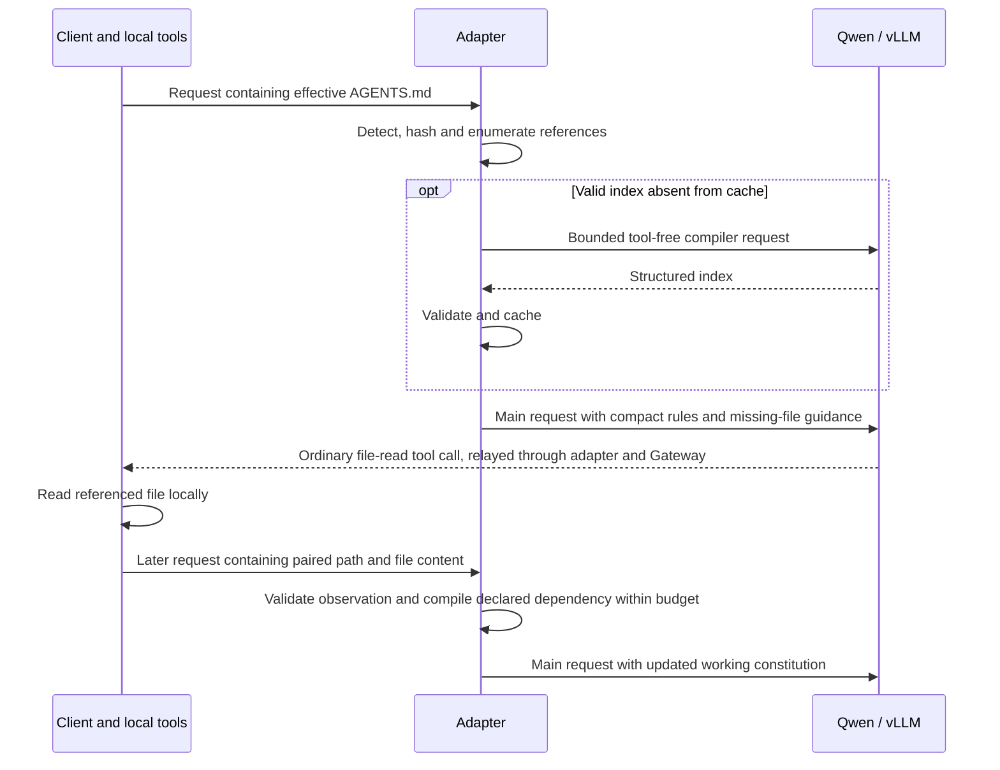

# SLAIF Local Coding architecture

SLAIF Local Coding sits immediately before a private model server. It adapts
requests from ordinary Codex and OpenAI-compatible clients to the capabilities
of a constrained local model, while preserving streaming, function tools and
ordinary API behavior.

Two problems drive the design: a local coding model needs project rules to
remain available after conversation history is compacted, and a one-image
vision model needs an explicit policy for requests containing earlier images
alongside a new crop. Both can be handled where the complete model-bound
request is available, without changing the client.

The human-approved [dependency-bundle cache
rework](docs/CACHE-REWORK.md) redefines how the first problem is solved:
instead of root-only compilation with a disposable derived cache, the adapter
acquires the actual governing documents the client reads, compiles them as
independent insertion bundles, and transactionally replaces the observed
originals with bounded compiled context in RAM. The approved design is the
normative target — the `dependency-bundles-v1` profile. The currently
implemented behavior remains explicitly named **legacy** until that migration
is qualified. Delivery state for every rework criterion is tracked in
[the stage ledger](docs/CACHE-REWORK-LEDGER.md), and the resolved engineering
choices are recorded in [the implementation
plan](docs/CACHE-IMPLEMENTATION-PLAN.md). As of the current stage the pure
observation slice is implemented as inert typed modules (not active
in the adapter) and has earned the D01-D05 root/path/read/result/
span observation — including the eligibility-independent call-
identity inventory (an unknown or ineligible call never acquires a
source, but a collision with an eligible call ID is a typed conflict
that cannot disappear through filtering, and missing, empty or
malformed call IDs remain observable without inventing an ID) and
structural causality (a result attaches to its matching call only
when its exact numeric structural position — the `input` item index,
or the Chat `messages` index of the assistant message carrying the
call — follows the call's, never via lexical call IDs or JSONPath
string sorting; a result before its call is a typed non-removable
`PRE_CALL_RESULT` chain with no bundle/member digest, no source span
and no proven-executed claim), the wire-family call inventory (the
Responses `custom_tool_call` identity is inventoried alongside
`function_call` for conflict bookkeeping only — it never earns read
acquisition and its opaque input is never reinterpreted), the
complete-inventory bounds (`max_commands`/`max_outputs` enforced
against every relevant call and result record, including
unsupported/custom/malformed-ID records, by a no-retention
streaming preflight decided before any record, location string,
identity map or diagnostic is retained), and the typed result-ID
observability (absent/empty and non-string result IDs are fixed
non-echoing unpaired limitations, never invented or attached), with
exact internal call/result IDs staying usable while operational
`str`/`repr` of report/read/unpaired objects never echo private ID
values (fixed `<private-id>` placeholder; the observable no-ID
state, fixed enums, counts, locations and digests remain visible) —
the D06/D07/D08 finite read plans,
the D07 literal-loop slice, and the public D10 composition matrix
with the pure D09 unsupported/partial negative matrix (rounds 017-b
through 017-p corrected that surface's bounded proof findings,
pairing identity, inventory boundaries, private-ID
representations and the per-nested-container scan guard; 017-p
also lands a Python-only disposable-CI containment capability
(`scripts/cache_native_containment_probe.py` plus
`scripts/cache_native_containment_ci.py`, with the
`cache-native-containment` job as the remote proof): digest-pinned
fixture image under explicit confinement, ordered token-bound
parent-death proof, bounded capture, verified image removal —
the first remote run at the previously published head `ec08a1b`
failed `runtime-invalid` and this round corrects the runtime-shape
handling, so the capability qualification is `PENDING` strategic
review (capability proof only: no genuine client/model/GPU/gateway
activity); the offline, opt-in,
fail-closed process-capture
utility (`scripts/real_client_capture.py`) exists for independent
strategic review — inert (not active in the adapter), hard-capped,
privacy-law enforced in code, with the actual-client path
input-gated (the generated startup readiness is `not_ready`;
caller-supplied `ready`/authorization records can launch the bound
stand-in through the public API) — so it performs no actual
capture, no process collector, and no model call, and no format or
process acquisition is earned. 017-r further lands the serial
right-pane native fixture preparation (typed phase/budget model,
distinct 21001/21002 confinement fixture image, ten fresh-container
scenarios driven by a Python-only disposable-CI
`cache-native-fixture` job; the public 0.164.0 musl artifact is
fetched, digest-verified and statically hashed — including the
pinned public LICENSE/NOTICE retention — but never executed): the
bounded 017-r fixture preparation is accepted (strategic
decision at head `2ce9dcd`, with the recorded wording
limitations), and D09 remains `NOT RUN`. The remaining
D09 actual-trace/
multi-chunk process-completion and process/chunk collector gap stays
with a later same-PR suffix (a later exact order may authorize one
bounded reviewed actual capture, then the process/chunk collector,
subject to review). 017-s further lands the local fixture
preparation and one bounded Python-only local rehearsal
(repo-owned stdlib-only preparer/supervisor
`scripts/cache_native_fixture_local.py`): one long-lived
non-Codex Python fixture owner behind the protected bounded
prepare/observe/rehearse/finish/abort lifecycle (single RAM run
context, one non-resettable 1800 s anchor plus one bounded 600 s
cleanup grace, exact CID registration before start, protected
control root outside the disposable work root), the section-2
verified local endpoint binding (read-only lstat of the
documented default unix socket, DOCKER_HOST pinned to that
verified socket in a frozen once-per-owner child environment,
explicit remote selections refused before any mutation) and the
one order-bound local rehearsal with the same reviewed
confinement (ran EXACTLY ONCE, bound to implementation head
`2a9c44e2ee327b965828bafdfcaf444abc3a581c` with source inputs `54ef177`,
PASSED, leaving no prepared container, supervisor, listener,
key file or owned image) — no native launch, no worker
suspension, no protected service or profile change
(`native_started` / `worker_stopped` / `codex_invoked` false
throughout; actual measured facts in the immutable round
report): the serial foreground handoff itself remains a later
separately authorized order, and D09 remains `NOT RUN`.
017-t finalizes the S evidence record and further lands the
inert native-handoff preparation boundary (typed immutable
order/run binding with per-order stable one-attempt
namespaces preserving the exhausted 017-s record, plus the
versioned read-only native preparation/evidence contract —
owner/native fact separation, the closed subject-identity
law bound to the exact registered CID/21002/exact argv/
pinned binary, independently measured same-job restoration,
closed verdict composition where a historical S-scope owner
record can never qualify native-ready, an honest
started-but-not-ready record never becomes ready, the
owner's registered artifact must equal the measured
subject executable, and the visible handoff requires an
actually bound, matched, nonzero expected PTY, the
native-owner evidence producer (full shared-payload
validation, digest recomputation, measured-context
binding, closed image-id forms, exact closed record key
sets), the real owned measurement adapter, and the public
prepare/observe/finalize workflow with no CLI, no
fabricated flags and the owner/subject run bound to the
immutable order/source-head/run binding; 169 pure/fake plus
tiny exact-owned Python child tests): no native launch, no
worker stop, no local Docker operation, no new rehearsal
(the S admission stays consumed); the later serial native
handoff remains a separately authorized order, and D09
remains `NOT RUN`. 017-u continues the same inert
preparation and repairs the complete-inventory law
(review 11: a stat-unreadable but positively still-existing
PID was silently skipped and minted a complete stop
receipt) — every listed process row is now tri-stated
through the bounded read-only absence seam (only an
independently verified-gone entry may be ignored, the
bounded churn law; an unreadable still-existing or
unprovable entry is a closed non-echoing refusal, never a
silently skipped listing row, and can never establish
nonmembership, a complete group or a complete stop; a
failed initial prepare/observe mints no baseline and a
refused stop can never later claim a recorded stop or
restoration), with the unchanged four-case group-
readability probe passing 4/4 at the repaired source.
017-v materializes the small EXPLICIT public
native-owner lifecycle composition (repo-owned
stdlib-only `scripts/cache_native_fixture_native_
owner.py`, `NativeOwnerRun`): the verified immutable
order/run binding selects the authority of its OWN
order at the REAL fixture-owner constructor (the S
default and the historical S opt-in unchanged; a
new-order binding requires a live bound admission in
the order's stable one-attempt namespace before
adoption and re-validates the real repository context
READ-ONLY through the actual resolver; the owner
adopts the binding's minted run identity with no
second mint or admission; a post-admission
constructor failure closes the same run honestly),
ONE shared owner, RAM run context, absolute END
anchor, ledger and cleanup grace across the bounded
public lifecycle (start/prepare/observe/record_stop/
register_subject/finish/abort), the public staged
subject registration (only after prepare and the
separately measured stop; the CURRENT stable-stop
predicate re-verified before any identity commit; the
frozen W/B baseline unchanged; the registered run
immutable; a refused registration commits nothing),
the DISTINCT native-scope owner terminal record
(`slaif-native-owner-run-evidence-v1` — the S
measured facts WITHOUT the historical S whole-run
false assertions; the S record is never relabeled),
the closed native-run terminal record
(`slaif-native-owner-run-v1`) with its consumer's
cross-field readiness law and the protected 0600
atomic no-overwrite retention, and the HONEST
publication ordering (a terminal fail/aborted
finalized honestly at convergence; a converged pass
keeps the bound attempt running; the protected native
record retained FIRST and the same-order journal
finalized ONLY THEN; a failed publication never
leaves an admitted pass; the real finalize token
retained in RAM only): 12 pure/fake composition tests
driving the REAL owner finish/export/teardown code
with fake platform operations over ONE coupled fake
process world; no actual Docker operation, no native
launch (including help/version), no worker stop, no
real fixture admission in the real checkout, no host
signal, no CLI entry; the later serial native handoff
remains a separately authorized order, and D09
remains `NOT RUN`.
017-w closes the remaining same-owner coherence
gaps (the public staged registration is bound,
before any staged receipt commit, to THIS SAME
prepared owner's measured registration — the
owner's own registered CID and artifact binary
must be measured and equal the operator's
expectation, a matching foreign
expectation/channel or foreign expected +
measured binary can never redefine the owner's
subject, a refused registration commits nothing
and a later matching registration in the same
still-valid phase remains possible; the actual
repository context at the actual owner
construction is compared with the ORIGINAL frozen
binding through the complete revalidation seam,
not a fresh resolution whose result is discarded —
a post-admission identity drift is refused before
owner adoption with the already-won attempt
closed terminal `fail` and no external action,
and a contradictory `bind_head` argument is
refused; native publication for the completed
owner is a ONE-SHOT terminal transition — the
ACTUAL bound journal state is read, never
assumed, the pass path requires the attempt still
running, a pre-retention measurement/validation/
serialization/destination failure closes the
still-pending attempt truthfully with the primary
closed refusal propagating unchanged (an
unexpected serialization error surfaces as
`internal`), the protected record is retained
FIRST, and a post-retention unverified or raced
finalization is a closed failure preserving the
retained bytes and the actual journal facts as-is,
with any fresh-path retry refused without a new
qualifying record, relabel or journal reset): the
composition suite grows to 19 pure/fake tests (7
new); no actual Docker operation, no native
launch (including help/version), no worker stop,
no real fixture admission in the real checkout, no
host signal, no CLI entry; the later serial
native handoff remains a separately authorized
order, and D09 remains `NOT RUN`.
017-x executes the ONE bounded outcome the earlier native-preparation
rounds left to a separately authorized order: with a REAL finite Python-
only fixture, determine whether the existing unprivileged host CID
channel — the order prose `HostCidScopedTable`, which names the existing
`RealCidScopedTable` channel, a naming clarification only — can measure
the CURRENT executable of an actual UID/GID 21002 process WHILE IT IS
ALIVE (repo-owned stdlib-only driver
`scripts/cache_native_fixture_exec_capability.py`, closed record
`slaif-017x-exec-capability-driver-v1`): the SEALED bound child owns
resolve+admit ONCE before any external work (the driver only verifies
the child's closed protected outputs — never re-resolves, re-mints,
adopts or replaces a run id; an exhausted running journal is refused,
never adopted or reconstructed); the fresh protected bootstrap startup
authority (a pre-existing control root is a prior/foreign owner's
surface, never adopted — no command, no journal mutation — and the
published state is bound to the actual still-live child PID); the
prepare -> hold -> finish lifecycle over ONE shared owner/run/ledger/END
issues the ONE closed detached stand-in hold exec (UID/GID 21002 on the
held prepared exact CID, the issued 32-hex run marker on argv, ONE
subject start INCLUDING failed starts); the bounded exact-CID discovery
(the owner's guarded `top` is the closed membership authority — every
query charges the same ledger/deadline, at most 96 rows, host /proc
never enumerated, per-attested-pid in-scope verification with tri-state
absent vs closed refusal, the issued-marker kernel-cmdline correlation
FRESH against the pre-launch inventory); the scoped current-executable
read (16 MiB / 10 s clamped at measurement to the same remaining owner
END intersected with the issued hold's finite lifetime, birth-bound,
before/after frame law; an unreadable or absent executable is a closed
unknown, never an artifact-hash fallback); the honest `verified-gone`
(absence only, never an exit code or termination cause); the owner's own
bounded abort on any pre-finish failure (never a host signal) with the
retained terminal evidence validated bound to this exact attempt; the
budget is the owner's published END plus one cleanup grace (an expired
budget refuses before any blocking wait); and the W-order publication
(the bound verified owner evidence retained first, the driver's
protected capability record second — `--record-out` required by the CLI
preflight and outside the work root (a closed
read-only refusal before any launch) — and the
verified same-attempt terminal finalization only
on the real `finalized` token; a refusal closes
fail with no journal pass
and no fresh-path retry): a driver pass is a closed truthful conclusion
in which an unknown or a refusal is a useful diagnostic, never
readiness. 34 focused tests in three distinct layers — the real CLI
admission grammar (including the child-owned resolve+admit law), the
scripted driver bootstrap over an ACTUAL launched Python child (startup
authority, the scripted full positive, the full-driver refusals), and
the in-process real public-owner measurements (the coupled positive
measures the scoped read BEFORE the owner finish; the terminal
publication orderings) — over fake platform seams plus tiny exact-owned
Python children: a useful fake proof of the named mechanisms, not one
full sealed-real-owner end-to-end test. The actual outcome of the ONE
authorized bounded Python-only attempt RAN EXACTLY ONCE at literal
implementation head `e5215ce1a96b4dbecdcca5157b6a21ef30a6b1da` (run
`9fd5cf1d95924a47b8bf53e8624242a5`): a terminal FAIL at prepare-target with `controller-not-ready`, `capability` null — no complete preparation, hold, subject identity or executable result (neither a readable nor an unreadable executable was established); the admission is terminal fail and is never reset, retried or relabeled; the
measured outcome is recorded in the immutable round report. No native
launch, no worker stop, no host signal; the later serial native
handoff remains a separately authorized order, and D09 remains `NOT
RUN`.
017-y adds the closed readiness diagnosis to that driver and the
SECOND explicit sealed entry (the 017-y entry, closed record
`slaif-017y-exec-capability-driver-v1` paired ONLY with that entry;
the historical S/X entries and the consumed X namespace unchanged): on
a nonzero bounded readiness exec, ONLY the fixed probe's own exact
finite closed failure record refines the original `controller-not-ready`
category (`controller-not-ready:<cause>` — the fixed measured causes
`uid-not-21001`, `pid1-uid`, `health-unreachable`; a missing,
malformed, multiple/duplicate, foreign, over-bound or contradictory
output is the fixed unknown; a raw exception or Docker failure is
never a measured cause; no raw output is ever persisted); the
readiness failure path records NO readiness-poll count (an unmeasured
quantity, never a claim of zero actual readiness polls); and the ONE
conditional bounded lifecycle query (issued only when the readiness
exec produced no closed record — exactly one allowlisted read-only
`docker inspect` of the single finite fact `.State.Status` on the SAME
registered CID, charged to the SAME owner ledger/END — only the closed
line `exited` refines to `controller-not-ready:container-exited`, and
any other status, any other output shape and EVERY query failure
(including a bounded timeout and a transport failure) stay honestly
unknown: a query failure is NOT absence); a retained capability record
is valid ONLY under its canonical sealed entry (caller-created
descriptors and cross-entry pairs are closed refusals), and the
terminal retention/qualification propagates the entry through both the
pass and fail paths, the matching record retained FIRST and only then
the pass finalization. Ten focused tests were added across the three
fixture suites (ci 224, local 50, exec_capability 38).
The actual outcome of the ONE separately bound 017-y attempt
RAN EXACTLY ONCE at literal implementation head
`35a3bcd7322535dd4a699efc53c0c1c62d4c942e` (run
`fbe526a3290d465298bc8da61ef2a304`): a closed driver PASS with the
complete preparation, confinement and Python-PTY phases; the subject
uniquely identified and measured from the exact-CID inventory
(UID/GID/groups 21002, birth-bound), then observed `verified-gone`
after the bounded hold (absence only — never an exit code or
termination cause), while the current executable remained the
closed UNKNOWN (no digest; not native readiness and no proven
kernel/errno cause); the admission is terminal pass and is never
reset, retried or relabeled; the measured outcome is recorded in the
immutable round report. No native launch, no worker stop, no host
signal; D09 remains `NOT RUN`.
017-z lands the inert versioned fixture identity contract
(`scripts/cache_native_fixture_identity.py`, software-only): two
closed, explicitly named, immutable identity descriptions — the
ORIGINAL fixed controller 21001 / subject 21002 profile (remains
the CURRENT fixture identity; every old record/schema/constant
meaning unchanged) and an INERT owner-UID candidate (subject
UID/GID equal to the captured eligible host owner's
real/effective/saved values, each triple's three values equal,
nonroot, strict finite Linux IDs 1..4294967294, distinct from the
controller identity; expected subject groups exactly the primary
GID, never host supplementary groups) — with a strict closed
record codec (bounded bytes, exactly one mapping, no duplicate
keys; malformed/duplicate/over-bound/missing/extra/contradictory
input refused with fixed non-echoing reasons), a deterministic
canonical configuration fingerprint (a configuration digest that
binds complete profile semantics — never a process hash, trusted
identity receipt, admission, cache key or readiness certificate),
and a bounded READ-ONLY host-owner-ID collector (direct stdlib
getresuid/getresgid plus the simple uid/euid/gid/egid getters,
one collection, explicit unsupported/unavailable outcome; no
fs/proc traversal, no env/config/profile read, no network, no
subprocess, no signal, no privilege mutation). Construction
enforces the complete field laws, so no description with a
mutable alias or an invalid field can exist. Typed objects,
decoded data, profile names, fingerprints and caller flags NEVER
establish measured authority: the contract selects no live
profile, records no fixture admission and yields no ready/native
verdict; the later sealed child must select a canonical profile,
collect/freeze actual owner IDs, bind them to its ORIGINAL
verified order/head/run and live admission before external work
and revalidate the same context at use — described, not
implemented here. 19 focused tests (48 collected cases); no
actual fixture/Docker/admission/native work, no
`.oap-local/017-z` root; D09 remains `NOT RUN`.
017-aa integrates that inert owner-UID contract through the real
fixture owner and the Python capability driver (software-only:
the integrated path stays input-gated and UNQUALIFIED until a
later actual order — no actual local Docker/fixture/owner
startup, admission, native/extra Codex, worker stop, signal, TTY
handoff or model/Gateway call in this round).  The one canonical
future sealed entry `017-ab` (driver record
`slaif-017ab-owner-uid-exec-capability-v1`, selecting only
`slaif-fixture-identity-owner-uid-v1`) is defined and fixed now
but remains INACTIVE: it is never created, activated, admitted
or launched in this round, and actual repository-context
validation refuses it under the active state before any external
fixture work.  When a later order activates it, the sealed child
keeps sole resolve+admit ownership and the real owner then
collects and freezes its OWN eligible host IDs (its own
real/effective/saved UID and GID observations, through the 017-z
production collector) after its original verified order/run wins
admission; that one immutable context is revalidated at actual
use and never rebased after drift, and a caller-supplied
description or ready flag never establishes measured origin.
The frozen profile carries through the build (an explicit
owner-variant Dockerfile using only the frozen validated IDs,
same pinned base, same confinement, root-owned immutable profile
DATA — failing closed, never falling back to original), build
arguments, subject ownership, the owner-scoped guarded executor
(exact independent UID:GID; the original fixed-21002
defaults and every old record/semantics remain the current
qualified path, byte-for-byte — the consumers extend only
through the shared private structural core, the public v1
wrappers stay strict), controller accounting, stand-in
measurements,
host exact-CID discovery and the distinct versioned AB
state/evidence/driver records.  The owner-UID cleanup proof is
exact registered-CID lifetime membership — never a host UID scan
— and a post-admission startup refusal converges through the
same single owner convergence as every terminal path (the
already-won attempt closes honestly; a foreign pre-existing
control root is never adopted or deleted).  14 new canonical-entry
tests in the exec-capability suite (now 52) plus the new 40-test
owner-UID suite, over fake platform operations in distinct
honest layers — useful fake proof, not a sealed-real-owner
end-to-end qualification; no native-ready or v1 runtime claim;
D09 remains `NOT RUN`.
017-ab activates that sealed entry and executes the ONE
bounded actual PYTHON-only fixture capability
qualification on the same PR25 (no source change: at the
literal attempt head
`cdb6a101ecbd6d687f8ad413b9505c7198000758`, run
`87ee9c006d7f4de98d11af2dfbe5bd5c`, all 17 helper
bytes, the runtime source, the 199-input map and both
artifacts were verified identical to qualified AA, and
all 10 CI checks were green at that head). The existing
public driver ran EXACTLY ONCE, Python-only, over the
real local Docker endpoint. The outcome is a closed
driver PASS: the sealed child won the ONE admission;
the real owner collected and froze its OWN eligible
host identity (subject UID 1001, GID 1001, expected
groups exactly the primary GID `[1001]` — measured
values, never a caller flag); the preparation,
confinement and Python-PTY phases completed under the
unchanged confinement (controller 21001/21001; 1 GiB
memory/no swap; 1 CPU; pids 96; bounded tmpfs budgets;
empirical keyring syscall denial, EPERM, under the
matching host UID); the ONE capability-hold subject was
uniquely identified from the exact-CID inventory
(pid/birth-bound, closed argv; pre/post inventory 1/2
rows) and its current executable was MEASURED through
the existing unprivileged scoped CID channel (sha256
`4dbf3143240288fb2170257ffaa7bd030cdda5d2703d1f5f30b627042267e2e3`
— the first measured executable for this entry class,
distinct from the X null and the Y unknown); the subject
was then observed `verified-gone` after the bounded
hold (absence only — never an exit code, signal, errno,
kernel cause or natural-exit provenance); the exact-CID
cleanup converged (descendants 1 before / 0 after;
container and owned image verified absent; the unrelated
same-UID worker and host sentinel survived); and the
publication ordering held (verified owner evidence
first, driver record second, same-attempt terminal
finalization last — ONE terminal-pass journal entry;
owner exit 0; driver exit 0). The pinned native
artifact (308139304 B) was fetched, hashed and baked
but NEVER executed. This is a bounded Python-only
diagnostic capability qualification on the owner-UID
profile — NOT native-ready, NOT whole-017 acceptance,
NOT v1 runtime delivery: full-017
native/current-binary/right-pane format/PTY, D09, the
required-syntax audit and ALL 018-024 remain
mandatory. The admission is terminal pass and is never
reset, retried or relabeled; the measured outcome is
recorded in the immutable round report. D09 remains
`NOT RUN`.
017-ac integrates the existing owner-UID fixture
composition with the native handoff path (software-only,
amending PR25): the ONE canonical future sealed entry `017-ad` is
fixed now but INERT, input-gated and UNQUALIFIED — its
entry constant names the unique order path
`oap/orders/017-ad-owner-uid-native-handoff-qualification.md`
required for the LATER strategic activation (not an
already-committed or activated AD order, no run
authority; the real AD order file is absent from this
checkout — the incident is disclosed in the round
report) — actual repository-context validation
refuses it under AC-active BEFORE any external work
or admission (hermetic synthetic repositories only,
never the real checkout).
The SAME real owner's OWN bounded OS identity
collection — frozen after its ORIGINAL won admission,
before external work — is carried through the EXISTING
public NativeOwnerRun / preparation / measurement /
evidence composition: the frozen owner image/exec/
stand-in/native subject, expected PTY, staged
registration, owner evidence, native terminal record,
closed consumer verdict and same-attempt finalization
all use the SAME frozen context — revalidated by
comparison at EVERY identity-bound use (construction,
prepare, hold start, finish AND registration), never
rebased; a host identity that drifted after the
measured stop is refused at registration before any
channel construction or receipt commit, commits
nothing, and the same won attempt converges honestly.
DISTINCT versioned identity-bearing tags are introduced
wherever the original or AB-only tags cannot honestly
represent AD (the original fixed-21002 and the AB
consumers stay strict, including equal-numeric
cross-profile separation); the retained-record
consumers stay coherent with the ORIGINAL frozen
workflow context (a valid foreign frozen identity, or a
relabeled original-tag record of the AD order, can
never become ready — the exact tag-pair law keeps the
original tag for the historical entries only). The
native executable measurement uses the ACTUAL current
bytes through the EXISTING unprivileged registered-CID
channel with coherent before/after frames and bounded
streaming at exactly 320 MiB / 10 s clamped at USE to
the SAME remaining owner END (overbound/slow/
unreadable/raced a closed refusal/unknown, no
artifact-hash fallback; the original Python 16 MiB /
10 s bound unchanged). No global owner-UID
membership/cleanup scan (exact registered-CID plus
owned PID/birth lifetimes, tri-state absence; the
unrelated same-UID worker survives with the SAME
uid/gid/birth).  The new
`tests/test_cache_native_fixture_native_handoff.py`
suite (22 tests, three named layers) covers the
ACTUAL public composition: its COUPLED
public-lifecycle layer drives the REAL
constructor/admission/prepare/stop/register/observe/
finish/restore/publish over ONE coherent coupled
fake process world (the useful 1001:1002 positive
and the coupled contrasts, including the
post-PREPARE registration drift with no commit and
no rebase); its named pure-data and
admission/constructor layers cover the frozen
subject-identity construction law, the AD channel
closed fields, the retained-record consumer grammar,
the three pre-admission
AC-active/canonical-path/foreign-path refusals and
the two post-admission
uncollected/mismatched-identity constructor failures
(over owned synthetic repositories).  EVERY
started test owner is reaped in a per-test finally
before monkeypatch teardown (the bounded exact-owner
abort is issued only while still held; an
already-converged owner is simply joined, so a
positive test finishes normally and stays a pass; no
framework, no host cleanup). NO actual local
Docker/fixture/owner startup or admission, NO native
launch, NO worker stop, NO real host signal, NO
model/Gateway call; the later serial native handoff
remains the separately authorized `017-ad` order. D09
remains `NOT RUN`; no native-ready or v1 runtime claim.
017-ad activated that sealed AD entry and closed
PARTIAL: the ordered actual single-attempt native
handoff qualification was NOT RUN — never PASS, never
waived — because the required private preparation
found the pre-admission engineering gap (no existing
seam produces the native expected PTY independently;
the candidate host /dev/pts delta was rejected because
kernel devpts mounts have independent allocation
domains), with the checkpoint 0001–0003 findings
accepted WITH QUALIFICATION and the corrected primary-
source-verified proc tty_nr encoding (distinct from
the kernel-internal MKDEV layout) recorded in the
immutable AD report. No source/helper/test/lock/
workflow change occurred in that round; the order and
active were committed exactly (implementation head
`6bd535b8a633a14c3ee0301662fd7a53cd57b94a`; the
PARTIAL report is the report-only SELF
`8489dce5e2e9d20f321848ecdfd74f589451a19a`) and all 10
implementation and all 10 report-head checks are
SUCCESS.
017-ae repairs that missing prerequisite SOFTWARE ONLY
(no native/client launch, no actual local fixture
operation, no new runner/transport/privilege
mechanism/framework; no adapter/cache/parser/compiler/
image/Gateway/model behavior change; all original
S/X/Y/AB/AD schemas, sealed entries, defaults and
consumed namespaces unchanged): the independent
native-attach PTY expectation producer through the
EXISTING fixture owner, guarded exact-CID exec channel
and NativeOwnerRun composition. ONE future canonical
sealed entry `017-af` (owner-UID profile; unique path
`oap/orders/017-af-owner-uid-native-pty-qualification.md`)
is fixed now but INERT: its constant names the LATER
strategic activation — the real AF order/namespace/
admission/owner is absent now — and under AE-active it
is refused before admission or any external work
(hermetic synthetic repositories only); it is
selected only by its own entry and carries DISTINCT
identity-bearing AF tags (`slaif-017af-*` state/prep/
owner-evidence/attach-binding/native-run/run-evidence)
while the original, AB and AD consumers stay strict.
The AF entry owns ONE non-resettable attach-binding
phase in the SAME owner/RAM context/absolute END/
ledger: a measured (possibly empty) baseline after
prepare and the separately measured stable stop, then
ONE bounded same-namespace second observation
deriving an expectation ONLY from a unique fresh owned
allocation (churn/reuse/ambiguity/malformed → typed
refusal; a consumed failed phase never re-samples; the
legal devpts node GID is governed by the MEASURED
devpts policy, never assumed equal to the process
GID), under the primary-source-verified proc tty_nr
encoding (distinct from MKDEV) with finite signed
limits. The producer is a minimal fixed read-only
`python3 -I -S -c` probe admitted ONLY by the AF guard
(the old guards refuse it byte-for-byte in meaning),
bounded at 96 slave rows / 65536 bytes / 5 s clamped
at every use to the remaining owner END (overbound is
a refusal, never truncation; the measured probe UID
must equal the frozen subject UID). Public staged
registration goes through the EXISTING exact
registered-CID default channel (caller overrides
refuse) with the measured per-subject devpts namespace
verification (bounded `/proc/<attested-pid>/root/dev/pts`
metadata reads, 5 s bound clamped to the SAME
original owner END, coherent before/after frames,
final identity revalidation before any receipt
commit): matching tty numbers, fabricated/replayed
allocation receipts, stale stops, PID reuse, drift or
expiry across a blocking read never establish origin,
and a refusal commits nothing while the SAME won
attempt converges honestly. The proof drives the REAL
public composition over ONE coherent coupled fake
process world with the useful 1001:1002 positive, in
honestly named layers (pure-data, coupled public-
lifecycle, admission/constructor, at-use boundary),
every started test owner reaped in a per-test finally
(the abort issued only while still held) and the
original S/X/Y/AB/AD suites unchanged (full fixture
regression over all eleven fixture suites 818 cases
green pre-commit; the prescribed locked B gate is
the final qualification). NO actual local
Docker/fixture/admission/native/client/model/Gateway
operation or worker stop occurred this round; the
bounded process deviations are disclosed in the round
report and private checkpoints. D09 remains `NOT RUN`;
no native-ready, whole-017 or v1 runtime claim; the
later ACTUAL qualification belongs to the separately
authorized `017-af` order, strategy-chosen.
Detailed round history is in [the stage
ledger](docs/CACHE-REWORK-LEDGER.md) and the immutable OAP
transcripts; the versioned contract is [the observation
contract](docs/CACHE-OBSERVATION-CONTRACT.md); no v1 runtime
mechanism is active or qualified yet.

This guide explains the components, data flow and design limits. For deployment,
start with [QUICKSTART.md](QUICKSTART.md) or [INSTALL.md](INSTALL.md). Exact
configuration is described in [the configuration reference](docs/ADAPTER-CONFIGURATION.md);
implementation constraints are collected in
[the normative agent architecture](ARCHITECTURE-for-agents.md).

## System overview

The diagram shows logical ownership. In the canonical colocated deployment,
the Gateway runtime, adapter and model endpoint share the host network
namespace so both internal hops can use true loopback. The client repository
stays on the client workstation; the adapter has no mount or direct access to it.

| Component | Responsibility |
| --- | --- |
| Client | Conversation history and local tool execution, including reading repository files. |
| Separate [SLAIF API Gateway](https://github.com/ulfe-lmi/slaif-api-gateway) | Public keys, authentication, permissions, quotas, accounting, route administration and TLS. |
| Local Coding adapter | Private API forwarding, route policies, image adaptation, governance observation, compilation, cache and injection. |
| Qwen/vLLM | Model inference through its private OpenAI-compatible API. |
| Operator | Deployment, protected credentials, explicit policies, resource limits and recovery. |

The adapter is CPU-only. It does not load model weights, import a model runtime,
reserve GPU memory, decode images or start another vLLM process. Compiler calls
use the existing upstream model and therefore still consume inference capacity.

## Deployment and trust boundaries

The primary distribution is a pull-based Docker image for Linux `amd64`, with
Compose v2. The adapter container uses `network_mode: host`: its
`127.0.0.1:18020` upstream is the host's loopback, and its default listener is
`127.0.0.1:18031`. A direct-host systemd user service is the secondary path.
Docker installation needs no host Python, uv or local image build.

A Gateway in a bridge container or on another host cannot reach the adapter
through that Gateway's own `127.0.0.1`. The supported alternative uses an
explicit host-interface address on a declared trusted private LAN, with the
full signed ingress contract. A non-loopback adapter bind without that contract
is rejected. The adapter and vLLM remain private; only the Gateway is the public
entry point.

Signed requests authenticate identity and integrity; they do not encrypt
traffic. A private IP address alone provides no confidentiality. Broader
multi-host deployments require a separate transport decision. The supported
variants and namespace requirements are detailed in
[TOPOLOGY.md](docs/TOPOLOGY.md), with container isolation tradeoffs in
[DOCKER-SECURITY-DELTA.md](docs/DOCKER-SECURITY-DELTA.md).

### Authentication and identity

Public client keys terminate at the Gateway. On the Gateway-to-adapter hop,
production ingress requires a service Bearer credential and a separate HMAC
signature binding the method, path, raw query hash, exact body hash, opaque
principal, session, repository, route, timestamp and nonce.

Verification precedes image transformation, compiler/cache access and upstream
work. The signed route must match the selected route. Caller-supplied internal
headers cannot establish identity, and the adapter strips service credentials
and identity headers before forwarding with the private upstream credential.
Signed mode never falls back to a static identity.

Replay protection stores nonce digests in bounded process-local state. It keeps
a nonce through the inclusive signed timestamp horizon and configured retention
period. Capacity exhaustion and unsafe clock rollback fail closed rather than
evicting protected entries. This is a **single-worker contract**: replay state
is neither durable across restart nor shared across processes.

The exact wire contract is in
[SLAIF-GATEWAY-INTEGRATION.md](docs/SLAIF-GATEWAY-INTEGRATION.md). The frozen
Gateway compatibility authority belongs to the artifact's provenance record;
continuous contract testing does not silently change that release authority.

## Request lifecycle

This is the transformation path for supported model requests under the current
**legacy** profile. Governance stages run only when explicitly enabled.
Health/model discovery and other accepted passthrough requests do not undergo
constitutional rewriting. Internal compiler calls go directly upstream and
never enter this pipeline again.

The v1 profile keeps authentication, image policy and passthrough behavior,
then commits the governance transformation transactionally: locate root and
file-read observations and their exact outer spans, update the versioned
dependency graph, admit bundles (lean or greedy), resolve RAM hits or compile
misses, select a complete in-budget working set, and replace the observed
original source spans with stable references plus usable compiled content only
when replacements, references, selected content and session state all agree.
The request is then serialized and forwarded exactly once.

The API layer owns `/healthz`, `/readyz` and private `/metrics`. It proxies
`/health`, `/v1/models`, `/v1/responses` and `/v1/chat/completions`. It preserves
ordinary function-tool envelopes, supported reasoning settings, usage, status
codes and SSE event order, subject to documented header filtering and safe error
handling. It does not assemble an entire streaming response before forwarding;
a downstream disconnect closes upstream work.

Route configuration chooses supported model/endpoints and transformation
policies. Unknown or contradictory policies fail validation rather than being
guessed from request content. A configured Responses tool policy can remove
unsupported `tool_search` and `web_search` declarations; an explicit tool choice
that depends on a removed tool is rejected. Ordinary function tools remain
intact. This does not provide hosted tool execution or full OpenAI API parity.

## Keeping project rules available

A *constitution* is the effective project guidance rooted in `AGENTS.md`, plus
its binding referenced documents. Source files, Git, GitHub and human
decisions remain authoritative over any derived state.

### Current (legacy) profile — implemented

The active pipeline compiles the observed root into a small, validated
representation and adds it to subsequent applicable model requests; it acquires
only the dependencies the root declares, from narrowly paired evidence. This
behavior is explicitly named legacy, remains in effect until the v1 migration
is qualified, and is not a v1 delivery. Governance observation, compilation
and injection are opt-in. The legacy pipeline handles one complete root per
request. Multiple or incomplete roots preserve the request after image policy
instead of choosing an arbitrary root. A request with no root can reuse valid
process-local context only when rehydration is enabled and its complete
identity matches.

#### Observe first, then interpret

Detection requires envelope or path evidence: a supported Codex project
instruction envelope, an `AGENTS.md` input-file item, or a tool result paired
with a supported file-read operation. Merely mentioning `AGENTS.md` is not
enough. Only bytes actually received across the API boundary are available.

Before involving the model, deterministic code enumerates candidate repository
references and their evidence from links, quoted/backtick paths and supported
path-like text. It normalizes relative paths and rejects unsafe paths, traversal
and URLs. The model may classify and rank the candidates; it cannot silently
remove them from the manifest.

#### Compile with a bounded internal call

On a cache miss, the compiler sends source text and the enumerated candidates
directly to the private upstream. The call is text-only, tool-free,
non-recursive, size-limited, time-limited and output-limited. Concurrent identical
misses are deduplicated; compiler concurrency defaults to one.

The result must pass a strict schema before entering the cache. It includes
binding rules and evidence, authority boundaries, exceptions, ordering
constraints, dependencies and conditions requiring a full-source reread. Two
separate scores prevent a common ambiguity:

| Field | Meaning |
| --- | --- |
| `reference_confidence` | How confidently the reference identifies a repository file. |
| `constitutional_priority` | How authoritative or important that file is if it exists. |

A clearly referenced example may have low authority; a less clearly formatted
security instruction can have high importance. Priority classes distinguish P0
root guidance, P1 delegated binding law/security, P2 procedures, P3 architecture
and contracts, and P4 background/examples.

The compiler treats the input as data. It cannot execute instructions, fetch a
URL, read the client filesystem or invoke client tools. Schema validation and
bounds constrain its output; they do not prove perfect semantic interpretation.

#### Acquire dependencies through ordinary client tools

Missing binding dependencies produce guidance to read the exact files before
substantive mutation. Acquisition depends on the client's ordinary tools and
supported path/content pairing; the adapter does not independently fetch files
or ingest unrelated tool output. The legacy dependency acquisition budget is
finite.

#### Select and inject

The legacy working set uses a deterministic order: root P0, acquired P1,
missing P1 acquisition guidance, then relevant acquired P2/P3 entries within
the remaining budget. P4 is omitted. Optional entries are omitted whole;
essential rules are never silently truncated to fit.

Injection uses Responses `instructions` or the earliest appropriate Chat system
location. The marker identifies reconstructed context and makes clear that
source documents override it. Identical version/content is idempotent;
unexpected marker collisions or unsafe request shapes fail closed. Tools,
continuation identifiers and other unrelated fields are preserved.

After successful injection, bounded process-local state retains validated
indexes and inclusion metadata. A later request with reduced history can
reselect and inject them without another compiler call. This state expires and
is lost on restart. It restores available guidance at the model boundary; it
does not guarantee that a client will compact less often or that a model will
follow every rule.

### Approved rework: the `dependency-bundles-v1` profile (planned)

The human approved ten rules for how this problem must be solved; they are
recorded verbatim in [the handoff](docs/CACHE-REWORK.md) and summarized here
as the normative target. The mechanism below is **planned, not implemented**
(the pure D01-D05 observation slice exists as inert typed modules, not
active in the adapter); [the stage ledger](docs/CACHE-REWORK-LEDGER.md)
tracks each criterion as `NOT RUN` or `PENDING` until its implementation
stage lands and is reviewed.

1. **Recognize the root.** Detect the explicit Codex `AGENTS.md` envelope and
   extract its complete observed text and directory identity.
2. **Discover dependencies recursively.** Parse explicit `.md` references from
   the root and from subsequently observed reachable documents, resolving them
   against the referring document's directory; track a graph with shared
   nodes and cycles. The agreed filename convention excludes spaces.
3. **Observe actual content insertions.** Recognize supported file-read tool
   calls, pair results by call ID, assess read completion/truncation, and
   locate the content region — including combined multi-file reads.
4. **Configure bundle admission.** `lean` admits a whole bundle only when every
   member is graph-eligible (it may admit an isolated eligible portion when
   boundaries are proven); `greedy` admits the whole bundle when at least one
   member is eligible. Neither admits an arbitrary unrelated single file.
5. **Cache insertion bundles independently.** `[A,B]`, `[A]` and `[B]` are
   distinct entries even when their bytes overlap; a duplicate is acceptable
   because working storage is RAM with explicit safety ceilings, not a
   constrained disk budget.
6. **Replace originals only after successful preparation.** Preserve API/tool
   structure, replace the recognized raw-content span with a stable reference,
   and provide the appropriate compiled context; an opaque reference alone is
   not usable instruction content.
7. **Scale insertion size with effective context.** One file receives at most
   `effective_context_tokens / 32`; an N-file bundle receives N allowances; a
   separate aggregate injection budget reserves tokens for conversation, tools
   and generation.
8. **Compile once per version/configuration.** Reuse a valid compiled entry for
   unchanged content; source changes invalidate affected overlapping bundles;
   never inject stale state.
9. **Retain originals as evidence/recovery material.** Keep the exact
   extracted source bytes of the observed source bundles plus the necessary
   provenance in a protected per-session store, mandatory for an enabled v1
   profile; do not routinely return originals to model input or use them as a
   hidden fallback.
10. **Use RAM for the working cache; recover sessions from disk after
    restart.** Normal lookup/reinjection uses memory; per-session recovery
    records persist separately and are loaded only for sessions being resumed;
    recovery recompilation is the explicit exception to compile-once.

#### How the v1 pipeline differs from the legacy one

- **Evidence-based acquisition, not root declarations.** The dependency graph
  is extended from raw referenced Markdown as the client's ordinary reads
  cross the API boundary — single reads, multi-file `cat` bundles, chained
  commands, literal loops and absolute workspace paths, with per-read
  completeness evidence and exact outer content spans. The adapter parses a
  bounded read grammar; it never executes observed commands or touches the
  client or its own filesystem.
- **Whole bundles, typed identity.** A combined `cat A.md B.md` output is one
  attributable two-member bundle even without internal separators. Ordered
  members, exact content digests, versions and configuration identity make
  every bundle entry independent; a later singleton does not split an older
  bundle, and proven source changes invalidate overlapping entries.
- **Token-based insertion budgets.** Per-file allowances (`floor(C/32)` each,
  C from a validated route/session contract) plus an aggregate injection limit
  and explicit reserves replace the fixed byte budget; the pinned actual model
  tokenizer counts the final rendered block.
- **RAM ownership, no eviction.** All live graph, version, compiled-entry and
  selection state lives in memory. There is no TTL/LRU or capacity-driven
  eviction of live-session entries; real resource exhaustion surfaces as
  explicit backpressure or typed failure, never hidden churn or
  recompilation. The explicit configurable RAM safety ceilings (initial
  documented recommendations 512 MiB process / 128 MiB per session) account
  owned cache state — cache occupancy — not a guarantee of total process
  RSS.
- **Transactional replacement.** Observed original spans are replaced with
  stable references and usable compiled content only after compilation,
  selection and checkpoint preparation succeed; the transformation is
  idempotent under replayed history, and a failed preparation never deletes
  the only available governing content.
- **Restart recovery from exact originals.** A protected per-session recovery
  record (directory `0700`, file `0600`, atomic generation, integrity-checked)
  is mandatory for an enabled v1 profile and retains the exact extracted
  original source bytes and necessary provenance — never environment-context
  tails or full transport envelopes. After a restart, only a resumed
  authenticated session is rebuilt, in a new cache epoch, with bounded lazy
  recompilation.
- **Source-role authority is preserved.** Co-cached documents that the graph
  does not reach keep background provenance; nothing in a greedy bundle becomes
  a governing instruction by co-occurrence. The explicit reference policy is
  fixed: off-graph documents do not expand governing reachability until
  independently reachable, and a boundaryless mixed-eligibility bundle retains
  an unresolved-origin candidate whenever the eligible reference origin is not
  demonstrable.
- **Explicit failure and observability.** Failure states are typed (503 /
  409 / 422), never hidden; and every stage — root recognition, content
  acquisition, graph admission, compilation, RAM hit, replacement, injection,
  recovery, upstream acceptance — is independently observable, so root-only
  metrics can never qualify dependency caching again.

The exact contracts, configuration surface, failure table and acceptance
matrix are in [the handoff](docs/CACHE-REWORK.md); the resolved engineering
choices (default admission mode, namespace rules, recovery policy, reserves,
no-retry compiler, single-worker ownership, selection law) are in [the
implementation plan](docs/CACHE-IMPLEMENTATION-PLAN.md).

## Cache and state lifetime

| State | Profile | Contents and lifetime |
| --- | --- | --- |
| Request memory | both | Observed source and request data needed for that request; no raw-payload persistence. |
| Compiled-index cache (filesystem) | legacy (implemented) | Validated derived indexes; bounded filesystem storage with TTL, LRU and a separate bounded P0/P1 budget. Disposable; never authoritative. |
| Rehydration map | legacy (implemented) | Validated indexes and selection metadata for matching later requests; process-local, TTL/LRU/byte bounded; lost on restart. |
| RAM bundle state | v1 (planned) | Live graph, file/bundle versions, compiled entries, selection and single-flight state per session; no TTL/LRU or capacity eviction of live entries; lost on restart. |
| Per-session recovery record | v1 (planned) | Exact admitted original source bundles and metadata in a protected opt-in store; loaded only when that session resumes after restart; operator-owned retention. |
| Client repository | both | Full authoritative documents and history; never replaced by adapter state. |

Legacy cache identity incorporates principal, session/repository, source hash
and compiler/schema/model/policy versions; rehydration also binds selection/
render policies and bounds. V1 entry identity additionally binds ordered
member references, exact bundle digests, tokenizer and budget configuration,
render versions, admission mode and graph/root scope. A changed source or
incompatible version cannot silently reuse an old entry in either profile.

The legacy default cache location is `/dev/shm/slaif-local-coding`, with a
protected XDG filesystem fallback. Directories use `0700`, files `0600`, and
writes are atomic. Per-entry, total and pinned budgets are enforced. Derived
text is still sensitive even though raw prompts, images, source and tool
output are not persisted there. Cache deletion must never destroy
authoritative information. Under v1, working state never reads that
filesystem path on the normal hot path, and the only protected original-source
retention is the explicitly opted-in per-session recovery store described in
[SECURITY.md](SECURITY.md).

## Image adaptation

Image policy is explicit per route: `retain_newest`, `reject` or `passthrough`.
The designated one-image Codex route uses `retain_newest`. It keeps the newest
supported image content item by request traversal order and leaves non-image
content and its relative order intact.

Responses `input_image` and Chat `image_url` shapes are supported. Zero- and
one-image requests remain unchanged by image adaptation. For multiple images,
the result is checked against the route limit; unsafe over-limit shapes fail
closed. Images are neither decoded nor re-encoded.

Retaining a crop makes the full-image-then-crop workflow usable on a one-image
model. It does **not** preserve an intentional two-image comparison. Such a
workflow needs a capable route or an explicit rejection policy. Image policy
is independent of, and ordered before, both cache profiles.

## Failure behavior and observability

| Condition | Behavior |
| --- | --- |
| Invalid authentication, identity, route signature or replay | Reject before transformation or upstream work. |
| Malformed or oversized transformable request | Return a bounded client error; no unsafe bypass. |
| Compiler timeout, invalid output or cache failure (legacy) | Preserve original governance when safe; never cache invalid output as valid. Image enforcement remains independent. |
| Ambiguous/incomplete root or essential working-set overflow (legacy) | Preserve the post-image request instead of deleting or truncating governance. |
| Missing or expired rehydration state (legacy) | Preserve the request; no invented context or cross-principal reuse. |
| Unsupported or uncertain read evidence (v1) | Do not invent acquisition; the span passes unchanged with a fixed observable limitation. |
| Required transformation cannot be prepared (v1) | Reject/defer with a sanitized typed status (503 infrastructure/recovery/resource, 409 version/scope conflict, 422 budget/invalid transform); never forward dangling references or load disk originals as hidden fallback. |
| RAM safety ceiling reached (v1) | Fixed 503 backpressure with existing state preserved; no hidden eviction or disk hot path. |
| Unsafe image shape or marker collision | Reject explicitly. |
| Upstream unavailable | Return a sanitized gateway error; readiness fails. |
| Downstream disconnect | Close upstream work and release resources. |

Resource bounds cover request bytes, JSON structure, source size, compiler
output/time/concurrency, injection size, cache occupancy, replay state (both
profiles) and, under v1, explicit RAM safety ceilings. Streaming reduces
response memory pressure; compiler overhead remains a separate capacity cost.
Gateway reservation/final accounting stays with the Gateway, using provider
usage where available.

Operators use process liveness, readiness and private Prometheus-compatible
metrics. Metrics report fixed states, counts and timings for requests,
transforms, compiler/cache outcomes and failures. Raw prompts, repository
text, images, tool output, bodies, credentials and compiled content are
excluded from logs and metrics. Under v1 the metrics additionally
distinguish root recognition, actual content acquisition, graph admission,
first compilation, RAM hit, source replacement, compiled injection,
source-absent injection, actual native compaction, restart recovery and final
upstream acceptance, with no private filenames, digests, session values or
cache IDs in labels. See [SECURITY.md](SECURITY.md) for the privacy and
protected-host rules, and [DEPLOYMENT.md](docs/DEPLOYMENT.md) for operational
procedures.

## Implementation map

The implementation uses Python 3.12, FastAPI/Starlette, HTTPX, Pydantic and
Uvicorn, with locked dependencies managed by uv. The modules below are the
legacy implementation; the v1 rework revisits the same areas under the module
map in [the handoff](docs/CACHE-REWORK.md).

| Area | Source |
| --- | --- |
| API, ordered pipeline and streaming | [app.py](src/slaif_local_coding/app.py) |
| Validated runtime and route configuration | [config.py](src/slaif_local_coding/config.py) |
| Signed identity and replay protection | [gateway_identity.py](src/slaif_local_coding/gateway_identity.py) |
| Image and Responses tool policies | [image_policy.py](src/slaif_local_coding/image_policy.py), [tool_policy.py](src/slaif_local_coding/tool_policy.py) |
| Evidence-based observation and candidate enumeration | [detector.py](src/slaif_local_coding/constitution/detector.py), [references.py](src/slaif_local_coding/constitution/references.py) |
| Compilation and strict index contracts | [compiler.py](src/slaif_local_coding/constitution/compiler.py), [compiler_models.py](src/slaif_local_coding/constitution/compiler_models.py) |
| Derived cache (legacy) | [cache.py](src/slaif_local_coding/constitution/cache.py) |
| Dependency acquisition and rehydration (legacy) | [pipeline.py](src/slaif_local_coding/constitution/pipeline.py) |
| Working-set selection and endpoint injection | [working_set.py](src/slaif_local_coding/constitution/working_set.py), [injection.py](src/slaif_local_coding/constitution/injection.py) |
| Service entry point | [cli.py](src/slaif_local_coding/cli.py) |

## Verification, artifacts and limits

Verification combines pure unit tests, fake-upstream API/SSE/tool/disconnect
tests, security and isolation tests, pinned Gateway contract tests, and
reproducible artifact and disposable Docker qualification. Bounded live vLLM
and actual Codex tests supply separate fixture-specific evidence; a fake test
cannot substitute for either. The v1 rework adds its own planned test layers
and criterion-level gates recorded in [the stage
ledger](docs/CACHE-REWORK-LEDGER.md); RC10 is the historical baseline for the
rework, not a rework-qualified artifact. Exact commands and status meanings
are in [TESTING.md](TESTING.md).

The reference evidence is Qwen3.8-27B/vLLM on one RTX 3090 with 24 GB VRAM.
[Vision acceptance](docs/VISION-ACCEPTANCE.md) records the qualified fixture;
this is not generic hardware support, hostile multi-tenant certification,
frontier-model equivalence or a guarantee of instruction fidelity. Model context
and image limits depend on the selected serving configuration.

The wheel is the supported native distributable; the sdist is a developer
archive. Docker packages the wheel and locked runtime dependencies. Exact
source, wheel hash, toolchain, Gateway authority, configuration hashes and OCI
digest are recorded together. A mutable tag is an alias; the OCI digest is the
artifact identity. See [release-artifact policy](docs/RELEASE-ARTIFACT-POLICY.md)
and [RC handoff](docs/RC-HANDOFF.md). An RC record does not confer final public
release approval.

Installing or qualifying a candidate does not authorize replacing an existing
model service or changing Gateway routing. Protected-host cutover requires its
own authorization, baseline and rollback proof, as described in the
[cutover runbook](docs/RELEASE-CUTOVER-RUNBOOK.md).

The project is Apache-2.0. Reference RTX 3090 serving work is credited to
[syv-ai/qwen38-27b-rtx3090](https://huggingface.co/syv-ai/qwen38-27b-rtx3090);
[NOTICE](NOTICE) and [third-party notices](THIRD_PARTY_NOTICES.md) preserve
attribution. Model licensing is separate and model weights are not bundled.
Implementation history and acceptance transcripts live in
[the OAP archive](oap/README.md) and
[the historical roadmap](docs/IMPLEMENTATION-ROADMAP.md).
