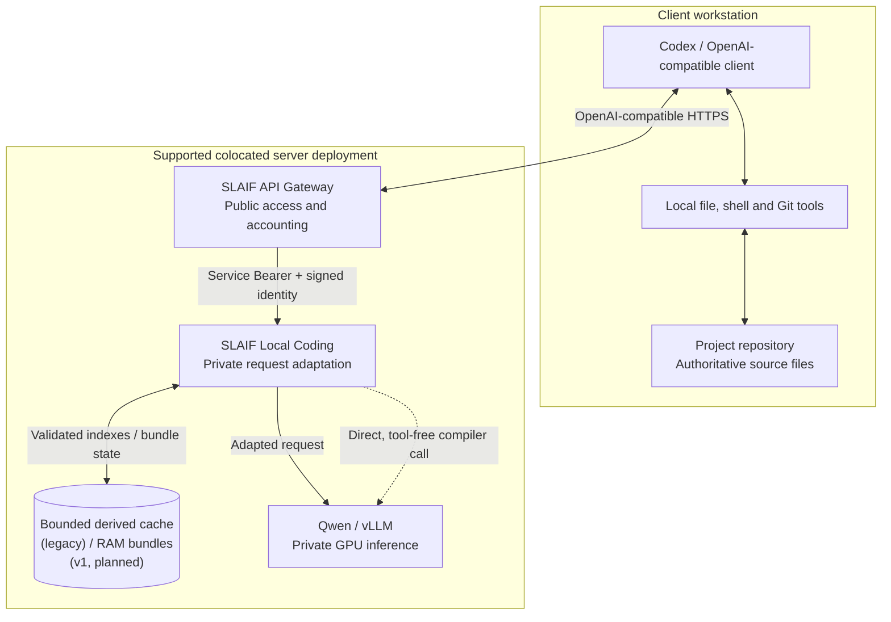
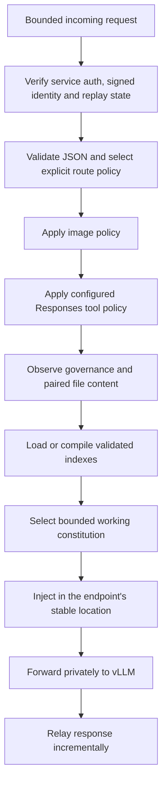
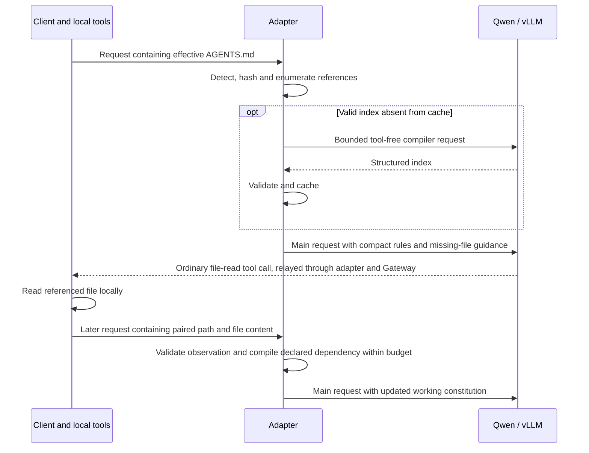
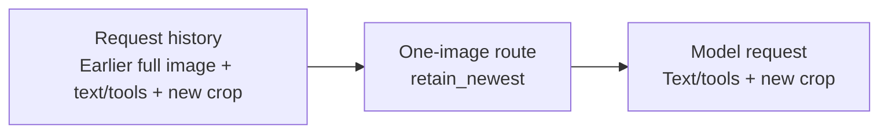

# SLAIF Local Coding architecture

SLAIF Local Coding sits immediately before a private model server. It adapts
requests from ordinary Codex and OpenAI-compatible clients to the capabilities
of a constrained local model, while preserving streaming, function tools and
ordinary API behavior.

Two problems drive the design: a local coding model needs project rules to
remain available after conversation history is compacted, and a one-image
vision model needs an explicit policy for requests containing earlier images
alongside a new crop. Both can be handled where the complete model-bound
request is available, without changing the client.

The human-approved [dependency-bundle cache
rework](docs/CACHE-REWORK.md) redefines how the first problem is solved:
instead of root-only compilation with a disposable derived cache, the adapter
acquires the actual governing documents the client reads, compiles them as
independent insertion bundles, and transactionally replaces the observed
originals with bounded compiled context in RAM. The approved design is the
normative target — the `dependency-bundles-v1` profile. The currently
implemented behavior remains explicitly named **legacy** until that migration
is qualified. Delivery state for every rework criterion is tracked in
[the stage ledger](docs/CACHE-REWORK-LEDGER.md), and the resolved engineering
choices are recorded in [the implementation
plan](docs/CACHE-IMPLEMENTATION-PLAN.md). Current delivery status: the pure observation slice is implemented as inert typed modules (not active in the adapter) and has earned the D01-D08 root/path/read/result/span observation slices — the eligibility-independent call-identity inventory (an unknown or ineligible call never acquires a source; a collision with an eligible call ID is a typed conflict that cannot disappear through filtering; missing, empty or malformed call IDs remain observable without inventing an ID), numeric structural causality (a result attaches to its matching call only when its exact numeric structural position follows the call's, never via lexical call IDs or JSONPath string sorting), the complete-inventory no-retention preflight bounds and the typed result-ID observability — plus the D09 process/chunk collector (017-al pure inert slice over the pinned native exec-wrapper format, plus the 017-am already-exited single-final acquisition and final-cat execution evidence; observation contract sections 5a and 11q) — with the D10 composition matrix and the D09 unsupported/partial negative matrix retained. The approved `dependency-bundles-v1` profile remains the normative target; its exact remaining runtime criteria (the transactional dependency-bundle replacement and its owning stages) are still pending, so no v1 runtime mechanism is active or qualified. Its versioned normative contract is [the observation contract](docs/CACHE-OBSERVATION-CONTRACT.md), and [the normative agent architecture](ARCHITECTURE-for-agents.md) carries the binding implementation map. The serial native-fixture qualification lineage is all bounded, with no GENERIC native-compatibility, whole-017 or v1 claim: 017-ad PARTIAL (the native handoff NOT RUN), 017-af FAILED (its one admission spent forever), 017-ah qualified at the bounded diagnostic scope, and 017-aj qualified the real native format at the bounded reference-fixture scope (a bounded native_ready=true verdict, recorded in the immutable round records); the D09 process/chunk collector is earned as a pure inert slice (017-al plus the 017-am already-exited single-final acquisition, closed at its bounded scope), and the D09 actual-trace process-completion qualification is qualified AT BOUNDED SCOPE in 017-am (the original selected AJ frames through the public composition with an explicit carrier conversion, both endpoints, four cases — contract section 11q); the sleep-bearing stream command stays a deliberate unearned read grammar (order section 2: process completion only, no read acquisition invented for such commands) and pinned native frames WITH the token-count section stay legacy-non-acquiring on the unchanged legacy surface (the intersection keeps its positive legacy reads). The binding fixture-qualification law and every per-round PID/hash/test-count fact are retained in the observation contract, [the stage ledger](docs/CACHE-REWORK-LEDGER.md) and the immutable OAP round reports. The EACH seven required literal families and their audit/remediation, and the whole-017 native-single literal audit, remain mandatory; whole-017 acceptance plus merge plus remote-main verification precedes 018-024, which remain the planned inert draft succession.

This guide explains the components, data flow and design limits. For deployment,
start with [QUICKSTART.md](QUICKSTART.md) or [INSTALL.md](INSTALL.md). Exact
configuration is described in [the configuration reference](docs/ADAPTER-CONFIGURATION.md);
implementation constraints are collected in
[the normative agent architecture](ARCHITECTURE-for-agents.md).

## System overview

The diagram shows logical ownership. In the canonical colocated deployment,
the Gateway runtime, adapter and model endpoint share the host network
namespace so both internal hops can use true loopback. The client repository
stays on the client workstation; the adapter has no mount or direct access to it.

| Component | Responsibility |
| --- | --- |
| Client | Conversation history and local tool execution, including reading repository files. |
| Separate [SLAIF API Gateway](https://github.com/ulfe-lmi/slaif-api-gateway) | Public keys, authentication, permissions, quotas, accounting, route administration and TLS. |
| Local Coding adapter | Private API forwarding, route policies, image adaptation, governance observation, compilation, cache and injection. |
| Qwen/vLLM | Model inference through its private OpenAI-compatible API. |
| Operator | Deployment, protected credentials, explicit policies, resource limits and recovery. |

The adapter is CPU-only. It does not load model weights, import a model runtime,
reserve GPU memory, decode images or start another vLLM process. Compiler calls
use the existing upstream model and therefore still consume inference capacity.

## Deployment and trust boundaries

The primary distribution is a pull-based Docker image for Linux `amd64`, with
Compose v2. The adapter container uses `network_mode: host`: its
`127.0.0.1:18020` upstream is the host's loopback, and its default listener is
`127.0.0.1:18031`. A direct-host systemd user service is the secondary path.
Docker installation needs no host Python, uv or local image build.

A Gateway in a bridge container or on another host cannot reach the adapter
through that Gateway's own `127.0.0.1`. The supported alternative uses an
explicit host-interface address on a declared trusted private LAN, with the
full signed ingress contract. A non-loopback adapter bind without that contract
is rejected. The adapter and vLLM remain private; only the Gateway is the public
entry point.

Signed requests authenticate identity and integrity; they do not encrypt
traffic. A private IP address alone provides no confidentiality. Broader
multi-host deployments require a separate transport decision. The supported
variants and namespace requirements are detailed in
[TOPOLOGY.md](docs/TOPOLOGY.md), with container isolation tradeoffs in
[DOCKER-SECURITY-DELTA.md](docs/DOCKER-SECURITY-DELTA.md).

### Authentication and identity

Public client keys terminate at the Gateway. On the Gateway-to-adapter hop,
production ingress requires a service Bearer credential and a separate HMAC
signature binding the method, path, raw query hash, exact body hash, opaque
principal, session, repository, route, timestamp and nonce.

Verification precedes image transformation, compiler/cache access and upstream
work. The signed route must match the selected route. Caller-supplied internal
headers cannot establish identity, and the adapter strips service credentials
and identity headers before forwarding with the private upstream credential.
Signed mode never falls back to a static identity.

Replay protection stores nonce digests in bounded process-local state. It keeps
a nonce through the inclusive signed timestamp horizon and configured retention
period. Capacity exhaustion and unsafe clock rollback fail closed rather than
evicting protected entries. This is a **single-worker contract**: replay state
is neither durable across restart nor shared across processes.

The exact wire contract is in
[SLAIF-GATEWAY-INTEGRATION.md](docs/SLAIF-GATEWAY-INTEGRATION.md). The frozen
Gateway compatibility authority belongs to the artifact's provenance record;
continuous contract testing does not silently change that release authority.

## Request lifecycle

This is the transformation path for supported model requests under the current
**legacy** profile. Governance stages run only when explicitly enabled.
Health/model discovery and other accepted passthrough requests do not undergo
constitutional rewriting. Internal compiler calls go directly upstream and
never enter this pipeline again.

The v1 profile keeps authentication, image policy and passthrough behavior,
then commits the governance transformation transactionally: locate root and
file-read observations and their exact outer spans, update the versioned
dependency graph, admit bundles (lean or greedy), resolve RAM hits or compile
misses, select a complete in-budget working set, and replace the observed
original source spans with stable references plus usable compiled content only
when replacements, references, selected content and session state all agree.
The request is then serialized and forwarded exactly once.

The API layer owns `/healthz`, `/readyz` and private `/metrics`. It proxies
`/health`, `/v1/models`, `/v1/responses` and `/v1/chat/completions`. It preserves
ordinary function-tool envelopes, supported reasoning settings, usage, status
codes and SSE event order, subject to documented header filtering and safe error
handling. It does not assemble an entire streaming response before forwarding;
a downstream disconnect closes upstream work.

Route configuration chooses supported model/endpoints and transformation
policies. Unknown or contradictory policies fail validation rather than being
guessed from request content. A configured Responses tool policy can remove
unsupported `tool_search` and `web_search` declarations; an explicit tool choice
that depends on a removed tool is rejected. Ordinary function tools remain
intact. This does not provide hosted tool execution or full OpenAI API parity.

## Keeping project rules available

A *constitution* is the effective project guidance rooted in `AGENTS.md`, plus
its binding referenced documents. Source files, Git, GitHub and human
decisions remain authoritative over any derived state.

### Current (legacy) profile — implemented

The active pipeline compiles the observed root into a small, validated
representation and adds it to subsequent applicable model requests; it acquires
only the dependencies the root declares, from narrowly paired evidence. This
behavior is explicitly named legacy, remains in effect until the v1 migration
is qualified, and is not a v1 delivery. Governance observation, compilation
and injection are opt-in. The legacy pipeline handles one complete root per
request. Multiple or incomplete roots preserve the request after image policy
instead of choosing an arbitrary root. A request with no root can reuse valid
process-local context only when rehydration is enabled and its complete
identity matches.

#### Observe first, then interpret

Detection requires envelope or path evidence: a supported Codex project
instruction envelope, an `AGENTS.md` input-file item, or a tool result paired
with a supported file-read operation. Merely mentioning `AGENTS.md` is not
enough. Only bytes actually received across the API boundary are available.

Before involving the model, deterministic code enumerates candidate repository
references and their evidence from links, quoted/backtick paths and supported
path-like text. It normalizes relative paths and rejects unsafe paths, traversal
and URLs. The model may classify and rank the candidates; it cannot silently
remove them from the manifest.

#### Compile with a bounded internal call

On a cache miss, the compiler sends source text and the enumerated candidates
directly to the private upstream. The call is text-only, tool-free,
non-recursive, size-limited, time-limited and output-limited. Concurrent identical
misses are deduplicated; compiler concurrency defaults to one.

The result must pass a strict schema before entering the cache. It includes
binding rules and evidence, authority boundaries, exceptions, ordering
constraints, dependencies and conditions requiring a full-source reread. Two
separate scores prevent a common ambiguity:

| Field | Meaning |
| --- | --- |
| `reference_confidence` | How confidently the reference identifies a repository file. |
| `constitutional_priority` | How authoritative or important that file is if it exists. |

A clearly referenced example may have low authority; a less clearly formatted
security instruction can have high importance. Priority classes distinguish P0
root guidance, P1 delegated binding law/security, P2 procedures, P3 architecture
and contracts, and P4 background/examples.

The compiler treats the input as data. It cannot execute instructions, fetch a
URL, read the client filesystem or invoke client tools. Schema validation and
bounds constrain its output; they do not prove perfect semantic interpretation.

#### Acquire dependencies through ordinary client tools

Missing binding dependencies produce guidance to read the exact files before
substantive mutation. Acquisition depends on the client's ordinary tools and
supported path/content pairing; the adapter does not independently fetch files
or ingest unrelated tool output. The legacy dependency acquisition budget is
finite.

#### Select and inject

The legacy working set uses a deterministic order: root P0, acquired P1,
missing P1 acquisition guidance, then relevant acquired P2/P3 entries within
the remaining budget. P4 is omitted. Optional entries are omitted whole;
essential rules are never silently truncated to fit.

Injection uses Responses `instructions` or the earliest appropriate Chat system
location. The marker identifies reconstructed context and makes clear that
source documents override it. Identical version/content is idempotent;
unexpected marker collisions or unsafe request shapes fail closed. Tools,
continuation identifiers and other unrelated fields are preserved.

After successful injection, bounded process-local state retains validated
indexes and inclusion metadata. A later request with reduced history can
reselect and inject them without another compiler call. This state expires and
is lost on restart. It restores available guidance at the model boundary; it
does not guarantee that a client will compact less often or that a model will
follow every rule.

### Approved rework: the `dependency-bundles-v1` profile (planned)

The human approved ten rules for how this problem must be solved; they are
recorded verbatim in [the handoff](docs/CACHE-REWORK.md) and summarized here
as the normative target. The mechanism below is **planned, not implemented**
(the pure D01-D05 observation slice exists as inert typed modules, not
active in the adapter); [the stage ledger](docs/CACHE-REWORK-LEDGER.md)
tracks each criterion as `NOT RUN` or `PENDING` until its implementation
stage lands and is reviewed.

1. **Recognize the root.** Detect the explicit Codex `AGENTS.md` envelope and
   extract its complete observed text and directory identity.
2. **Discover dependencies recursively.** Parse explicit `.md` references from
   the root and from subsequently observed reachable documents, resolving them
   against the referring document's directory; track a graph with shared
   nodes and cycles. The agreed filename convention excludes spaces.
3. **Observe actual content insertions.** Recognize supported file-read tool
   calls, pair results by call ID, assess read completion/truncation, and
   locate the content region — including combined multi-file reads.
4. **Configure bundle admission.** `lean` admits a whole bundle only when every
   member is graph-eligible (it may admit an isolated eligible portion when
   boundaries are proven); `greedy` admits the whole bundle when at least one
   member is eligible. Neither admits an arbitrary unrelated single file.
5. **Cache insertion bundles independently.** `[A,B]`, `[A]` and `[B]` are
   distinct entries even when their bytes overlap; a duplicate is acceptable
   because working storage is RAM with explicit safety ceilings, not a
   constrained disk budget.
6. **Replace originals only after successful preparation.** Preserve API/tool
   structure, replace the recognized raw-content span with a stable reference,
   and provide the appropriate compiled context; an opaque reference alone is
   not usable instruction content.
7. **Scale insertion size with effective context.** One file receives at most
   `effective_context_tokens / 32`; an N-file bundle receives N allowances; a
   separate aggregate injection budget reserves tokens for conversation, tools
   and generation.
8. **Compile once per version/configuration.** Reuse a valid compiled entry for
   unchanged content; source changes invalidate affected overlapping bundles;
   never inject stale state.
9. **Retain originals as evidence/recovery material.** Keep the exact
   extracted source bytes of the observed source bundles plus the necessary
   provenance in a protected per-session store, mandatory for an enabled v1
   profile; do not routinely return originals to model input or use them as a
   hidden fallback.
10. **Use RAM for the working cache; recover sessions from disk after
    restart.** Normal lookup/reinjection uses memory; per-session recovery
    records persist separately and are loaded only for sessions being resumed;
    recovery recompilation is the explicit exception to compile-once.

#### How the v1 pipeline differs from the legacy one

- **Evidence-based acquisition, not root declarations.** The dependency graph
  is extended from raw referenced Markdown as the client's ordinary reads
  cross the API boundary — single reads, multi-file `cat` bundles, chained
  commands, literal loops and absolute workspace paths, with per-read
  completeness evidence and exact outer content spans. The adapter parses a
  bounded read grammar; it never executes observed commands or touches the
  client or its own filesystem.
- **Whole bundles, typed identity.** A combined `cat A.md B.md` output is one
  attributable two-member bundle even without internal separators. Ordered
  members, exact content digests, versions and configuration identity make
  every bundle entry independent; a later singleton does not split an older
  bundle, and proven source changes invalidate overlapping entries.
- **Token-based insertion budgets.** Per-file allowances (`floor(C/32)` each,
  C from a validated route/session contract) plus an aggregate injection limit
  and explicit reserves replace the fixed byte budget; the pinned actual model
  tokenizer counts the final rendered block.
- **RAM ownership, no eviction.** All live graph, version, compiled-entry and
  selection state lives in memory. There is no TTL/LRU or capacity-driven
  eviction of live-session entries; real resource exhaustion surfaces as
  explicit backpressure or typed failure, never hidden churn or
  recompilation. The explicit configurable RAM safety ceilings (initial
  documented recommendations 512 MiB process / 128 MiB per session) account
  owned cache state — cache occupancy — not a guarantee of total process
  RSS.
- **Transactional replacement.** Observed original spans are replaced with
  stable references and usable compiled content only after compilation,
  selection and checkpoint preparation succeed; the transformation is
  idempotent under replayed history, and a failed preparation never deletes
  the only available governing content.
- **Restart recovery from exact originals.** A protected per-session recovery
  record (directory `0700`, file `0600`, atomic generation, integrity-checked)
  is mandatory for an enabled v1 profile and retains the exact extracted
  original source bytes and necessary provenance — never environment-context
  tails or full transport envelopes. After a restart, only a resumed
  authenticated session is rebuilt, in a new cache epoch, with bounded lazy
  recompilation.
- **Source-role authority is preserved.** Co-cached documents that the graph
  does not reach keep background provenance; nothing in a greedy bundle becomes
  a governing instruction by co-occurrence. The explicit reference policy is
  fixed: off-graph documents do not expand governing reachability until
  independently reachable, and a boundaryless mixed-eligibility bundle retains
  an unresolved-origin candidate whenever the eligible reference origin is not
  demonstrable.
- **Explicit failure and observability.** Failure states are typed (503 /
  409 / 422), never hidden; and every stage — root recognition, content
  acquisition, graph admission, compilation, RAM hit, replacement, injection,
  recovery, upstream acceptance — is independently observable, so root-only
  metrics can never qualify dependency caching again.

The exact contracts, configuration surface, failure table and acceptance
matrix are in [the handoff](docs/CACHE-REWORK.md); the resolved engineering
choices (default admission mode, namespace rules, recovery policy, reserves,
no-retry compiler, single-worker ownership, selection law) are in [the
implementation plan](docs/CACHE-IMPLEMENTATION-PLAN.md).

## Cache and state lifetime

| State | Profile | Contents and lifetime |
| --- | --- | --- |
| Request memory | both | Observed source and request data needed for that request; no raw-payload persistence. |
| Compiled-index cache (filesystem) | legacy (implemented) | Validated derived indexes; bounded filesystem storage with TTL, LRU and a separate bounded P0/P1 budget. Disposable; never authoritative. |
| Rehydration map | legacy (implemented) | Validated indexes and selection metadata for matching later requests; process-local, TTL/LRU/byte bounded; lost on restart. |
| RAM bundle state | v1 (planned) | Live graph, file/bundle versions, compiled entries, selection and single-flight state per session; no TTL/LRU or capacity eviction of live entries; lost on restart. |
| Per-session recovery record | v1 (planned) | Exact admitted original source bundles and metadata in a protected opt-in store; loaded only when that session resumes after restart; operator-owned retention. |
| Client repository | both | Full authoritative documents and history; never replaced by adapter state. |

Legacy cache identity incorporates principal, session/repository, source hash
and compiler/schema/model/policy versions; rehydration also binds selection/
render policies and bounds. V1 entry identity additionally binds ordered
member references, exact bundle digests, tokenizer and budget configuration,
render versions, admission mode and graph/root scope. A changed source or
incompatible version cannot silently reuse an old entry in either profile.

The legacy default cache location is `/dev/shm/slaif-local-coding`, with a
protected XDG filesystem fallback. Directories use `0700`, files `0600`, and
writes are atomic. Per-entry, total and pinned budgets are enforced. Derived
text is still sensitive even though raw prompts, images, source and tool
output are not persisted there. Cache deletion must never destroy
authoritative information. Under v1, working state never reads that
filesystem path on the normal hot path, and the only protected original-source
retention is the explicitly opted-in per-session recovery store described in
[SECURITY.md](SECURITY.md).

## Image adaptation

Image policy is explicit per route: `retain_newest`, `reject` or `passthrough`.
The designated one-image Codex route uses `retain_newest`. It keeps the newest
supported image content item by request traversal order and leaves non-image
content and its relative order intact.

Responses `input_image` and Chat `image_url` shapes are supported. Zero- and
one-image requests remain unchanged by image adaptation. For multiple images,
the result is checked against the route limit; unsafe over-limit shapes fail
closed. Images are neither decoded nor re-encoded.

Retaining a crop makes the full-image-then-crop workflow usable on a one-image
model. It does **not** preserve an intentional two-image comparison. Such a
workflow needs a capable route or an explicit rejection policy. Image policy
is independent of, and ordered before, both cache profiles.

## Failure behavior and observability

| Condition | Behavior |
| --- | --- |
| Invalid authentication, identity, route signature or replay | Reject before transformation or upstream work. |
| Malformed or oversized transformable request | Return a bounded client error; no unsafe bypass. |
| Compiler timeout, invalid output or cache failure (legacy) | Preserve original governance when safe; never cache invalid output as valid. Image enforcement remains independent. |
| Ambiguous/incomplete root or essential working-set overflow (legacy) | Preserve the post-image request instead of deleting or truncating governance. |
| Missing or expired rehydration state (legacy) | Preserve the request; no invented context or cross-principal reuse. |
| Unsupported or uncertain read evidence (v1) | Do not invent acquisition; the span passes unchanged with a fixed observable limitation. |
| Required transformation cannot be prepared (v1) | Reject/defer with a sanitized typed status (503 infrastructure/recovery/resource, 409 version/scope conflict, 422 budget/invalid transform); never forward dangling references or load disk originals as hidden fallback. |
| RAM safety ceiling reached (v1) | Fixed 503 backpressure with existing state preserved; no hidden eviction or disk hot path. |
| Unsafe image shape or marker collision | Reject explicitly. |
| Upstream unavailable | Return a sanitized gateway error; readiness fails. |
| Downstream disconnect | Close upstream work and release resources. |

Resource bounds cover request bytes, JSON structure, source size, compiler
output/time/concurrency, injection size, cache occupancy, replay state (both
profiles) and, under v1, explicit RAM safety ceilings. Streaming reduces
response memory pressure; compiler overhead remains a separate capacity cost.
Gateway reservation/final accounting stays with the Gateway, using provider
usage where available.

Operators use process liveness, readiness and private Prometheus-compatible
metrics. Metrics report fixed states, counts and timings for requests,
transforms, compiler/cache outcomes and failures. Raw prompts, repository
text, images, tool output, bodies, credentials and compiled content are
excluded from logs and metrics. Under v1 the metrics additionally
distinguish root recognition, actual content acquisition, graph admission,
first compilation, RAM hit, source replacement, compiled injection,
source-absent injection, actual native compaction, restart recovery and final
upstream acceptance, with no private filenames, digests, session values or
cache IDs in labels. See [SECURITY.md](SECURITY.md) for the privacy and
protected-host rules, and [DEPLOYMENT.md](docs/DEPLOYMENT.md) for operational
procedures.

## Implementation map

The implementation uses Python 3.12, FastAPI/Starlette, HTTPX, Pydantic and
Uvicorn, with locked dependencies managed by uv. The modules below are the
legacy implementation; the v1 rework revisits the same areas under the module
map in [the handoff](docs/CACHE-REWORK.md).

| Area | Source |
| --- | --- |
| API, ordered pipeline and streaming | [app.py](src/slaif_local_coding/app.py) |
| Validated runtime and route configuration | [config.py](src/slaif_local_coding/config.py) |
| Signed identity and replay protection | [gateway_identity.py](src/slaif_local_coding/gateway_identity.py) |
| Image and Responses tool policies | [image_policy.py](src/slaif_local_coding/image_policy.py), [tool_policy.py](src/slaif_local_coding/tool_policy.py) |
| Evidence-based observation and candidate enumeration | [detector.py](src/slaif_local_coding/constitution/detector.py), [references.py](src/slaif_local_coding/constitution/references.py) |
| Compilation and strict index contracts | [compiler.py](src/slaif_local_coding/constitution/compiler.py), [compiler_models.py](src/slaif_local_coding/constitution/compiler_models.py) |
| Derived cache (legacy) | [cache.py](src/slaif_local_coding/constitution/cache.py) |
| Dependency acquisition and rehydration (legacy) | [pipeline.py](src/slaif_local_coding/constitution/pipeline.py) |
| Working-set selection and endpoint injection | [working_set.py](src/slaif_local_coding/constitution/working_set.py), [injection.py](src/slaif_local_coding/constitution/injection.py) |
| Service entry point | [cli.py](src/slaif_local_coding/cli.py) |

## Verification, artifacts and limits

Verification combines pure unit tests, fake-upstream API/SSE/tool/disconnect
tests, security and isolation tests, pinned Gateway contract tests, and
reproducible artifact and disposable Docker qualification. Bounded live vLLM
and actual Codex tests supply separate fixture-specific evidence; a fake test
cannot substitute for either. The v1 rework adds its own planned test layers
and criterion-level gates recorded in [the stage
ledger](docs/CACHE-REWORK-LEDGER.md); RC10 is the historical baseline for the
rework, not a rework-qualified artifact. Exact commands and status meanings
are in [TESTING.md](TESTING.md).

The reference evidence is Qwen3.8-27B/vLLM on one RTX 3090 with 24 GB VRAM.
[Vision acceptance](docs/VISION-ACCEPTANCE.md) records the qualified fixture;
this is not generic hardware support, hostile multi-tenant certification,
frontier-model equivalence or a guarantee of instruction fidelity. Model context
and image limits depend on the selected serving configuration.

The wheel is the supported native distributable; the sdist is a developer
archive. Docker packages the wheel and locked runtime dependencies. Exact
source, wheel hash, toolchain, Gateway authority, configuration hashes and OCI
digest are recorded together. A mutable tag is an alias; the OCI digest is the
artifact identity. See [release-artifact policy](docs/RELEASE-ARTIFACT-POLICY.md)
and [RC handoff](docs/RC-HANDOFF.md). An RC record does not confer final public
release approval.

Installing or qualifying a candidate does not authorize replacing an existing
model service or changing Gateway routing. Protected-host cutover requires its
own authorization, baseline and rollback proof, as described in the
[cutover runbook](docs/RELEASE-CUTOVER-RUNBOOK.md).

The project is Apache-2.0. Reference RTX 3090 serving work is credited to
[syv-ai/qwen38-27b-rtx3090](https://huggingface.co/syv-ai/qwen38-27b-rtx3090);
[NOTICE](NOTICE) and [third-party notices](THIRD_PARTY_NOTICES.md) preserve
attribution. Model licensing is separate and model weights are not bundled.
Implementation history and acceptance transcripts live in
[the OAP archive](oap/README.md) and
[the historical roadmap](docs/IMPLEMENTATION-ROADMAP.md).
